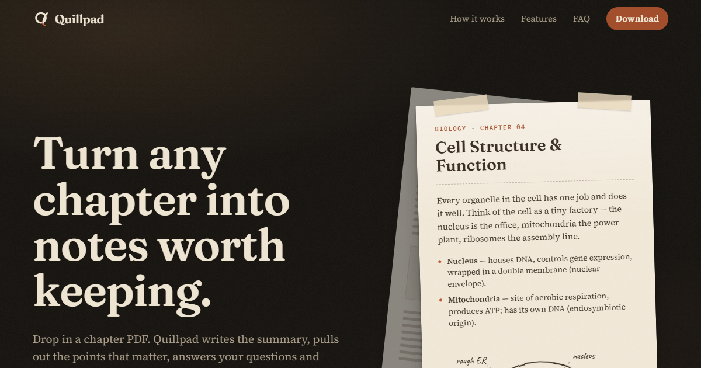
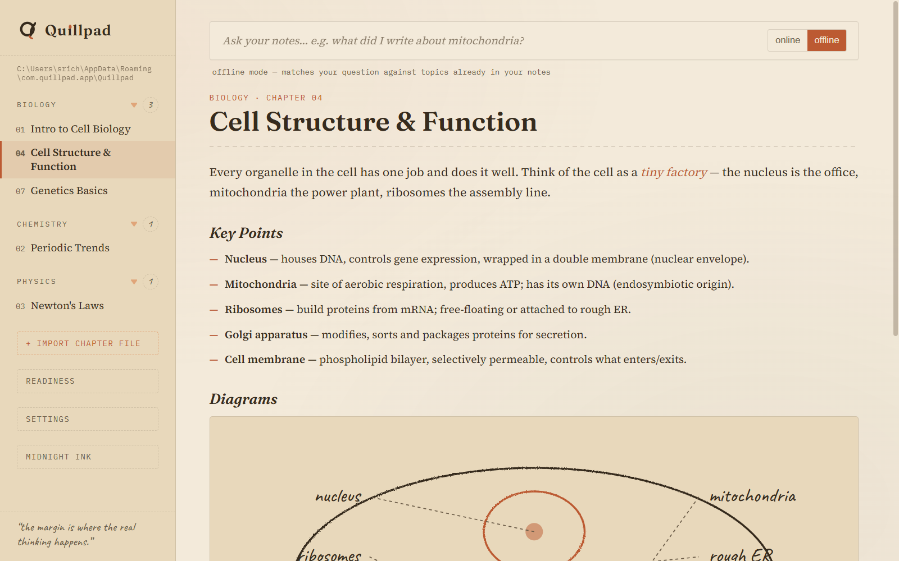
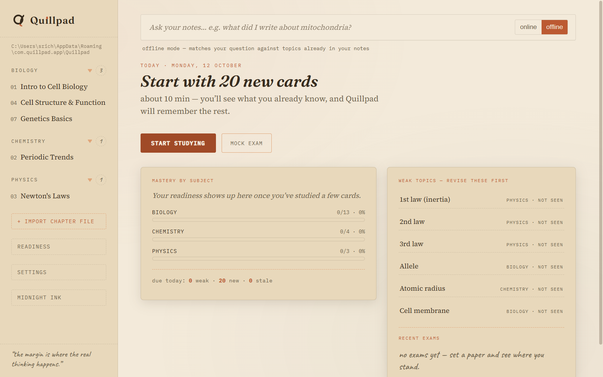
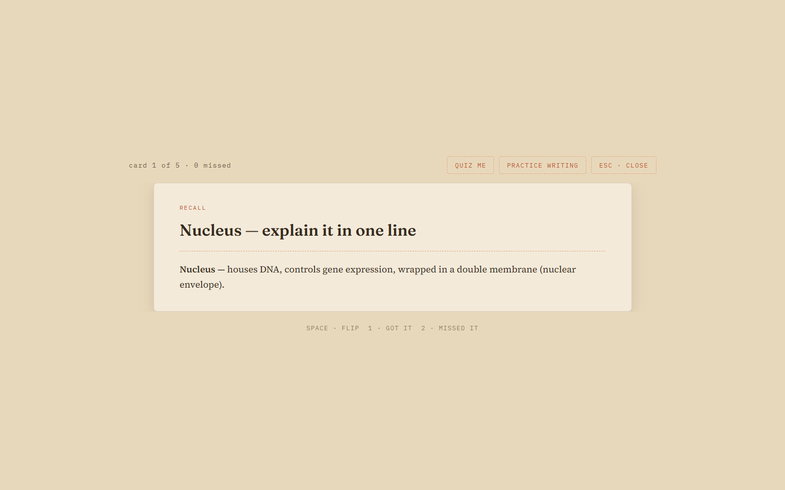
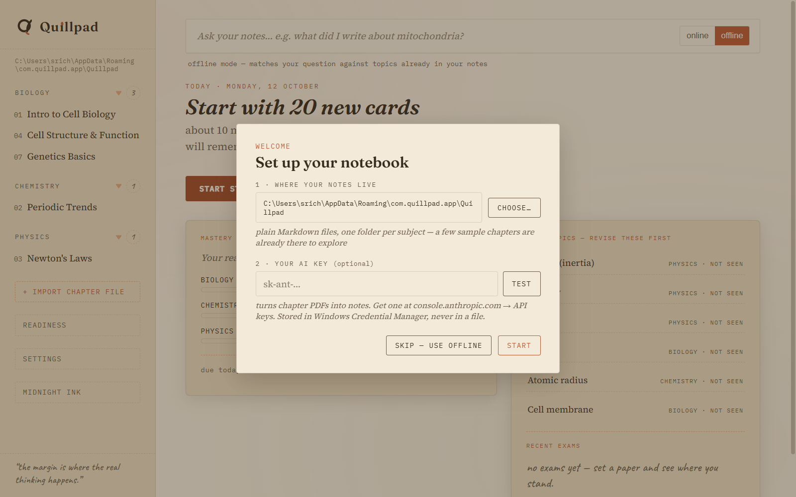

# Quillpad

**Turn any chapter into notes worth keeping, then actually remember them.**

Quillpad is a free Windows app for students. Drop in a chapter (PDF, Word or
PowerPoint, scanned or not) and it writes a short, clear note: a summary, the
key points, answers to the questions you care about, and the chapter's
diagrams redrawn as hand-drawn-style line art. Then it helps you study from
that note with flashcards, quizzes, practice writing and timed mock exams.



**[Download for Windows](https://github.com/uppalasrichaitanya/Quillpad/releases)**
· no account, no install, no cloud

[What it does](#what-it-does) ·
[Getting started](#getting-started) ·
[Getting your AI key](#getting-your-ai-key-2-minutes) ·
[Cost](#what-it-costs) ·
[Privacy](#privacy) ·
[FAQ](#faq) ·
[For developers](#for-developers)

## What it does

### Notes you can keep

Drag a chapter file onto the window (or use **+ import chapter file**). The
import wizard fills in the subject, chapter number and title from the file
name; you can add the important questions you want answered. Shortly
after, you have a note with:

- a short summary and the key points
- answers to the questions you supplied
- the chapter's diagrams, redrawn as clean line art you can read at a glance

Scanned PDFs work too: Quillpad detects them and reads the pages itself.



Notes are plain Markdown files in a folder on your disk, one folder per
subject. You can edit them, back them up, or open them in anything else.

### Study from them

- **Flashcards** built from each chapter's key points. Cards you miss come
  back; the ones you know get out of the way.
- **Quizzes** and **practice writing**, graded against your note.
- **Timed mock exams**, with a history of how you did.
- **A "today" dashboard** that tells you what to study next ("Start with 20
  new cards, about 10 min"), shows mastery by subject, and lists the weak
  topics to revise first.





### Ask your notes

Type a question and Quillpad points you to the chapter and line that answers
it. That works offline. With an API key it can also write a full answer from
your notes.

### Take it with you

Export a chapter as Markdown, as styled HTML or as a PDF, or make a one-page
cheat sheet for a whole subject. There is also a Midnight Ink dark theme for
late-night revision.

## Getting started

1. Go to [**Releases**](https://github.com/uppalasrichaitanya/Quillpad/releases)
   and download `Quillpad.exe` from the latest release (about 20 MB,
   portable, no installer).
2. Double-click it. If Windows SmartScreen says *"Windows protected your PC"*
   (the app is unsigned), choose **More info, then Run anyway**.
3. On first launch a short welcome asks where to keep your notes. Five
   sample chapters (Biology, Chemistry and Physics) are already there so you
   can look around.
4. Optional: paste an AI key and press **test**, or choose **skip, use
   offline**. You can add a key later in settings.



Quillpad needs **WebView2**, which is preinstalled on Windows 10 and 11. If
the window opens blank, install it from
[Microsoft](https://developer.microsoft.com/microsoft-edge/webview2/).

To check your download, the SHA-256 of `Quillpad.exe` is listed on the
release page.

### What works without a key

Everything except three things: turning chapters into notes, AI-written
answers to your questions, and generating quizzes. Reading, searching, offline
ask, flashcards, practice, mock exams and exports all work with no key and no
internet connection.

## Getting your AI key (2 minutes)

Chapter-to-note conversion, online answers and quiz generation use Claude
through **your own** Anthropic API key. You pay Anthropic directly for what
you use, and nothing goes through anyone else's server.

1. Go to [console.anthropic.com](https://console.anthropic.com), sign up, and
   add a little credit under **Billing**.
2. Open **API keys, then Create key**, and copy it.
3. In Quillpad: **settings, then AI key**. Paste it, press **test**, then
   **save**.

The key is stored in Windows Credential Manager, not in a file. The default
model is `claude-opus-5-5`. For cheaper notes, set **advanced, then model** to
`claude-sonnet-5-5`. Any Anthropic Messages-compatible endpoint can be set
under **advanced, then API base URL**.

## What it costs

Quillpad is free. The only cost is what Anthropic charges your account for the
AI features. A typical chapter costs a few cents to a few tens of cents,
depending on its length and the model you pick. You can set a monthly
spending limit in the Anthropic console, so there are no surprises.

## Privacy

- No account, no sign-up, no cloud.
- Your notes are ordinary files in a folder you chose.
- Your API key lives in Windows Credential Manager, never in a file.
- When you use an AI feature, the request goes straight from the app to
  Anthropic. Everything else stays on your computer.

## FAQ

**Is it really free?**
Yes. You only pay Anthropic for the AI calls you make, if you choose to add a
key. See [What it costs](#what-it-costs).

**Does it work offline?**
Yes, apart from converting chapters, AI-written answers and quiz generation.
See [What works without a key](#what-works-without-a-key).

**Is there a Mac or Linux version?**
Not yet. Quillpad is Windows-only for now.

**Where are my notes stored?**
In the folder you picked on first launch, as `.md` files grouped by
subject. The path is shown at the top of the sidebar, and you can switch to
another folder anytime in **settings**.

**Can I import PowerPoint or Word files?**
Yes: PDF, Word and PowerPoint, including scanned PDFs.

**Why does Windows warn me when I open it?**
The app is not code-signed, so SmartScreen shows a warning. Choose **More
info, then Run anyway**.

---

## For developers

Quillpad is built with **Tauri 2**: a Rust backend and a vanilla JavaScript
frontend, no framework and no database.

### Run from source

```bash
npm install
npm run tauri dev
```

Requires Node 22+, Rust (MSVC toolchain) and WebView2.

### Build

```bash
npm run tauri build -- --no-bundle
# -> src-tauri/target/release/quillpad.exe
```

### Tests

```bash
npm test                       # frontend logic tests
(cd src-tauri && cargo test)   # backend tests
```

The release QA log, including the fresh-user first-run checks, is in
[`docs/superpowers/qa/2026-10-12-qa.md`](docs/superpowers/qa/2026-10-12-qa.md).

### Notes format

Notes are Markdown with YAML front-matter (subject, num, title, questions,
created, pdf_path) and `##` sections, organized by subject and chapter:

```
Quillpad/
  Biology/
    01-intro-to-cell-biology.md
    04-cell-structure-function.md
  Chemistry/
    02-periodic-trends.md
```

Diagrams live in fenced ` ```quill-diagram ` JSON blocks inside the note, so
prose stays prose and diagrams stay structured. They are typed specs
(labelled-blob, trend-grid, process-flow, distribution-curve) that the
frontend renders as hand-drawn-style SVG. The slug drops punctuation rather
than expanding it, so `Cell Structure & Function` becomes
`04-cell-structure-function.md`.

Study progress is saved in `study-state.json` and mock exam results in exam
history; both autosave per action and are written atomically.

### Project layout

```
src/            frontend (vanilla JS, no framework)
  main.js         app shell, import wizard, offline search, study + exam flows
  onboarding.js   first-run welcome + key test
  ai-gate.js      "add a key" prompt in front of AI actions
  import-guess.js prefill subject / chapter / title from a file name
  cards.js        deck building and the study session runner
  readiness.js    mastery, weak pile, due deck
  exam.js         exam paper construction and scoring
  pdfr.js         PDF probe + page rendering for scanned chapters
  diagrams.js     typed diagram specs -> hand-drawn SVG
  quill.js        the Floating Quill brand mark
  styles.css      the field-notebook theme
src-tauri/      Rust backend
  note.rs         note format: parse + render markdown
  library.rs      settings (+ 0.1 migration), atomic writes, notes-folder scanning
  ai_config.rs    endpoint defaults, URL hygiene, plain-English API errors
  keystore.rs     API key in Windows Credential Manager
  distill.rs      PDF/office extraction, prompts, endpoint failover
  commands.rs     Tauri commands (the IPC surface)
  seed.rs         first-run seed chapters
notebook-seed/  first-run example chapters as real notes
tests/          frontend logic tests (npm test)
web/            the download website (see web/README.md)
scripts/make_icon.py   generates the app icon (Pillow)
```

### Website

The download page lives in [`web/`](web/README.md). Its demos use the real
sample chapters from `notebook-seed/seed.json`.

### Developer `.env` fallback

Normal users set their key in the app. For development, a `.env` next to the
exe or in a parent folder is still honoured as a fallback, using only
`QUILLPAD_*` variable names. See [`.env.example`](.env.example).
